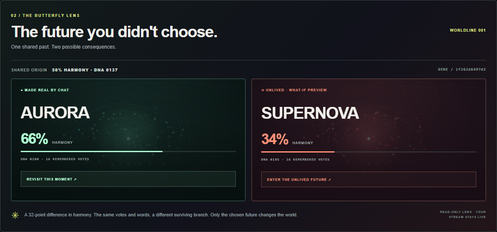

# PARALLAX — The Butterfly Effect of Twitch

**Your chat scrolls away. What if its choices stayed?**

PARALLAX is a Twitch chat experience with a cinematic streamer studio and an OBS browser overlay. Viewers choose between two procedural worlds. Their votes and words change the world inherited by the next round.

The **Butterfly Lens** reveals the other consequence: after a decision, explore the future chat did not choose. Both outcomes are calculated from the same starting world and contributions. Only the winning outcome changes the shared world; inspecting the alternative is a clearly labeled, local, read-only preview.



Built for the [Codex x TwitchCon Hackathon](https://twitchcon-codex.devpost.com/). This repository extends a starter supplied by the entrant. Actual Codex improvements and session provenance are documented in [CODEX_BUILD_LOG.md](CODEX_BUILD_LOG.md). Codex is the development tool; the running experience uses procedural rendering and does not require an AI API.

## Run locally in PowerShell

Requires **Node.js 20 or newer**. There are no npm dependencies to install.

```powershell
node --version
node server.js
```

Open [the studio](http://127.0.0.1:3000/) in a browser. For the credential-free walkthrough:

1. Click **OPEN THE RIFT**.
2. Click **SIMULATE 16 VIEWERS**. This is explicitly labeled simulation.
3. Click **COLLAPSE REALITY** and then **BACK TO THE MULTIVERSE**.
4. In **The future you didn't choose**, compare the two outcomes from their **SHARED ORIGIN**.
5. Click **ENTER THE UNLIVED FUTURE**. The stage enters **WHAT-IF PREVIEW**; the shared world and OBS overlay continue unaffected.
6. Click **RETURN TO LIVE**, then open another round to see the winning consequences carried forward.
7. Use **EXPLORE BOTH FUTURES** on a history entry to revisit that round's comparison.

Simulation is a local evaluation path, not evidence of a real Twitch connection. Live verification and publication status are tracked in [submission/FINAL_STATUS.md](submission/FINAL_STATUS.md).

| Local route | Purpose |
|---|---|
| `/` | Streamer studio and Butterfly Lens |
| `/overlay` | OBS browser source, showing the current shared world |
| `/how` | Short introduction |
| `GET /api/state` | Read-only JSON state |
| `GET /events` | Server-Sent Events stream |
| `POST /api/director` | Protected director actions |

## Connect your Twitch chat

The connector reads authenticated Twitch IRC over TLS. Obtain a **user access token** for the bot account using [Twitch OAuth](https://dev.twitch.tv/docs/authentication/getting-tokens-oauth/) and consult the [official IRC authentication requirements](https://dev.twitch.tv/docs/chat/irc/). IRC uses the `chat:read` and `chat:edit` scopes. The username must be the login of the token owner.

Set the channel and bot login in the same PowerShell window where you will start the server. This prompt keeps the token out of the displayed command and shell history:

```powershell
$env:TWITCH_CHANNEL = Read-Host 'Twitch channel login'
$env:TWITCH_BOT_USERNAME = Read-Host 'Token owner / bot login'
$twitchToken = Read-Host 'Twitch user access token' -AsSecureString
$env:TWITCH_OAUTH_TOKEN = [System.Net.NetworkCredential]::new('', $twitchToken).Password
node server.js
```

Stop any existing demo server first with `Ctrl+C`. Credentials are read at startup; `.env.example` is a reference and is not automatically loaded.

The studio must report a confirmed Twitch connection. Open a round and send `!a`, `!b` or `!spark hope` in that channel **from a separate viewer account**. Twitch does not echo a bot's own outgoing chat messages back as `PRIVMSG` to its IRC connection. Confirm the vote or spark appears in the studio and overlay.

When all three Twitch variables are set, demo injection is disabled, even if authentication fails. A failed connection must remain visibly disconnected. The connector handles PING/PONG, channel join confirmation, authentication failures and reconnect attempts. Automated parser tests exercise those inputs; they do not establish successful live account authentication.

Keep the token private and out of Git, footage and screenshots. After stopping the server, remove it from this shell when finished:

```powershell
Remove-Item Env:TWITCH_OAUTH_TOKEN -ErrorAction SilentlyContinue
$twitchToken = $null
```

## Add to OBS

Create an OBS **Browser Source** with URL `http://127.0.0.1:3000/overlay`, width **1920**, height **1080**, and **30 FPS**. Run the studio in a separate browser window. Both receive world updates through Server-Sent Events. The studio's what-if preview stays local and does not replace the OBS world.

For the submission, capture the project actually responding to Twitch chat and include genuine Codex build footage. See [submission/VIDEO_SCRIPT_EN.md](submission/VIDEO_SCRIPT_EN.md).

## Participation and world rules

| Chat command | Effect |
|---|---|
| `!a`, `!aurora` | Vote for branch A |
| `!b`, `!supernova` | Vote for branch B |
| `!future a`, `!future b` | Alternate voting syntax |
| `!spark hope` | Contribute a bounded, sanitized word to the round's visual DNA |

Names change across rounds; `!a` and `!b` always work. One username gets one vote and one spark per round. Repeat submissions are ignored. Votes cannot be changed. The server accepts contributions only during the voting window and closes it on expiry, or when the director collapses it early. **Branch A wins ties, including a round with no votes.**

At collapse, the engine:

1. Copies the prior world as the common origin.
2. Calculates branch A and branch B from that same origin, vote total and retained spark words.
3. Commits only the vote-winning branch to the shared world.
4. Archives both calculated outcomes, vote totals, words, origin and a deterministic decision fingerprint.

Harmony and entropy, cumulative vote memory and word count, and a small visual DNA seed carry into the next round. The DNA seed is a procedural rendering parameter; a spark is not an AI-generated semantic prediction. The decision fingerprint identifies stored inputs and outcomes; it is not a signature or proof that a Twitch event occurred. The Butterfly Lens displays historical calculated outcomes, not a second live universe or a prediction of real events.

## Storage and deployment

The server saves world metrics and the latest **12** outcomes to `.parallax-data.json`, ignored by Git. Saved history includes contributed words and aggregate vote counts, not OAuth tokens or raw chat transcripts. Current participant names and recent command activity appear in the studio and public state while the app runs. Use a channel where that display is appropriate.

A restart restores the world and history and returns the round to idle. Legacy records without both outcomes remain viewable as history; they cannot provide the new comparison until a new round is recorded. **RESET WORLD** clears the local world and history.

Default binding is `127.0.0.1`. For a remote host, set `HOST` and a secret `CONTROL_KEY`; non-loopback binding without a key is refused. The studio accepts the key in its director field. Configure HTTPS and suitable access restrictions before publishing a server. Credentials remain server-side; read-only state is not a private endpoint. `PORT` defaults to `3000`; `DATA_FILE` can select another persistence path.

## Verify

Run from the project directory in PowerShell:

```powershell
node --test
```

Or use `npm test`. The suite covers state transitions, vote and spark deduplication, deterministic alternate outcomes, deadline rejection, Twitch IRC parsing and HTTP director controls. Tests do not require Twitch credentials. Checked results and remaining limitations are recorded in [CODEX_BUILD_LOG.md](CODEX_BUILD_LOG.md).

The renderer uses browser Canvas and local JavaScript/CSS. The server uses Node's HTTP, TLS, crypto and filesystem modules. No external media, downloaded fonts, paid runtime service or build step is required.

## Submission materials

- [Devpost description in English](submission/DEVPOST_DESCRIPTION_EN.md)
- [English recording script, approximately 2:30](submission/VIDEO_SCRIPT_EN.md)
- [Verifiable delivery checklist](submission/SUBMIT_TODAY_ES.md)
- [Publication status and remaining account steps](submission/FINAL_STATUS.md)
- [GitHub and Devpost publishing guide](submission/GITHUB_SUBMISSION_ES.md)

Source is provided under the [MIT license](LICENSE).

## Optional development tools

`scripts/browser-qa.cjs` checks the actual studio and overlay in a headless browser. It needs Playwright available through `PLAYWRIGHT_MODULE` and an installed Edge browser (or set `BROWSER_CHANNEL`). Run it against a disposable local simulation: it resets that world.

`scripts/record-demo.cjs` records the running simulation, and `scripts/mux-demo.cjs` combines it with locally generated narration WAV files. They use `FFMPEG_PATH`; the recording also needs Playwright. The exported MP4 is a **rehearsal**, not evidence of a real Twitch or Codex UI session. English narration text and timing are in `scripts/narration.json`.

The production app and its engine/HTTP tests do not require any of these optional tools.
